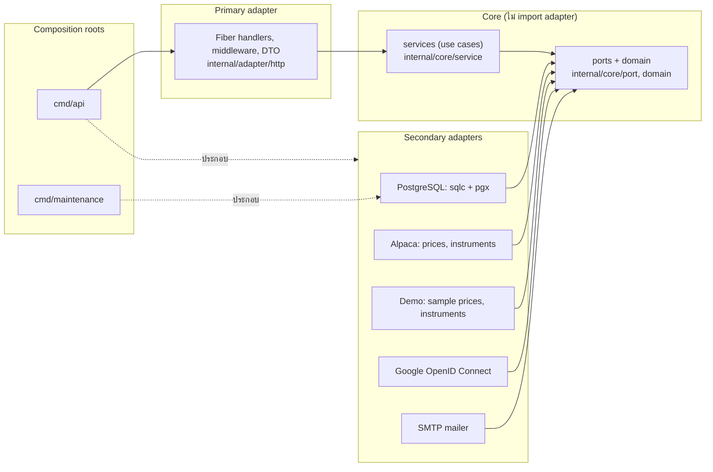
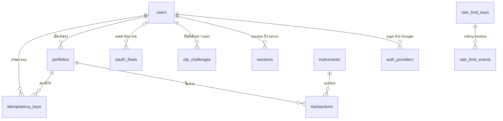

# Stock Portfolio Tracker — Backend


Go API สำหรับบันทึกรายการซื้อขายหุ้นสหรัฐฯ และติดตามต้นทุน/กำไรขาดทุนของหลายพอร์ต
ระบบนี้บันทึกการลงทุนที่ทำผ่านช่องทางอื่น ไม่ใช่ระบบส่งคำสั่งซื้อขายจริง

> **สถานะ:** backend เฟส 1 ครบทุก endpoint (milestone 1–8 ผ่านการตรวจรับ, milestone 9 กำลังตรวจรับ) — สมัครด้วยอีเมล+รหัสผ่านพร้อมยืนยันอีเมลด้วย OTP, login/logout ด้วย session ฝั่ง server, ลืมรหัสผ่านด้วย OTP, Google sign-in/เชื่อมบัญชี (เปิดเมื่อตั้งค่า `GOOGLE_*`), หลายพอร์ตต่อผู้ใช้ (ETag/If-Match), บันทึก/แก้/ลบรายการซื้อขาย (`Idempotency-Key`, ตรวจประวัติไม่ให้จำนวนหุ้นติดลบ), holdings และมูลค่าพอร์ตด้วยราคาล่าช้า (ตัวอย่างหรือ Alpaca SIP จริง) และ retention cleanup — ใช้งานผ่าน API/Swagger UI ได้เลย frontend (Next.js) เริ่มหลังตรวจรับ backend (milestone 10)

## เริ่มใช้งาน (dev พร้อม hot reload)

```bash
cp .env.example .env
docker compose up --build
```

`.env.example` มีค่า dev ครบทุกตัวแล้ว (รหัสผ่านและ secret ขึ้นต้น `dev-only-` ใช้ได้เฉพาะเครื่องของคุณ production ปฏิเสธ) จึงเปิดโหมดเดโมได้ทันทีโดยไม่ต้องมี Google, Alpaca หรือ SMTP จริง: ราคาเป็นข้อมูลตัวอย่าง (`is_demo: true`) และอีเมลไปที่ Mailpit
`docker compose up` โหลด `docker-compose.override.yml` อัตโนมัติ: mount source และ rebuild ด้วย air

เมื่อ API พร้อม (`http://localhost:8080/readyz` ตอบ 200) สร้างบัญชีเดโมที่มีสองพอร์ตและรายการตัวอย่างได้ด้วย

```bash
make demo-data   # demo-investor@example.com / Zq9!kVx1 (รหัสผ่านสำหรับเดโมในเครื่องเท่านั้น); รันซ้ำไม่ทำอะไรเพิ่ม
```

แล้วเปิด Swagger UI ที่ `http://localhost:8080/docs/` เพื่อ login และลองเรียก API

## เปิดแบบ production-like ในเครื่อง (ไม่โหลด dev override)

```bash
docker compose -f docker-compose.yml up --build
```

ใช้ image ที่ build แล้วและรันเป็น non-root; production จริงใช้ Supabase และ deployment config แยก (milestone 11)

## URLs

| URL | ใช้ทำอะไร |
| --- | --- |
| http://localhost:8080/healthz | process ทำงานอยู่ |
| http://localhost:8080/readyz | เชื่อม database ได้ |
| http://localhost:8080/docs/ | Swagger UI (bundle ใน image ไม่โหลด CDN) |
| http://localhost:8080/swagger.json, /swagger.yaml | Swagger 2.0 spec |
| http://localhost:8025 | Mailpit กล่องจดหมายปลอมสำหรับ dev |

URL ข้างบนใช้ได้ในเครื่อง (dev และ production-like); พอร์ตเปลี่ยนได้ด้วย `API_HOST_PORT`, `MAILPIT_UI_HOST_PORT`, `MAILPIT_SMTP_HOST_PORT` และ `POSTGRES_HOST_PORT` ใน `.env` ส่วน production ยังไม่มี URL จนกว่าจะ deploy (milestone 11) ซึ่งเอกสาร `/docs/` และ Try it out เปิด/ปิดแยกกันด้วย `DOCS_ENABLED` และ `DOCS_TRY_IT_OUT_ENABLED`

ทุก response มี `X-Request-ID` ใช้ค้น log ของคำขอนั้นได้

## Application log

```bash
docker compose logs -f api
```

Log เป็น JSON บรรทัดละ record (`time` UTC, `level`, `service`, `msg`, `event`, `request_id`)
Access log เก็บ method, route template, status และ duration โดยไม่เก็บ query string, cookies, headers หรือ body

## Database

- `deploy/db/bootstrap.sql` สร้าง roles `app_migrator` (เจ้าของ schema `app`), `app_runtime` และ `app_maintenance` ตอน volume ว่าง
- service `migrate` รัน goose ด้วย `app_migrator` และเก็บประวัติใน `app.goose_db_version`; `api` จะเริ่มเมื่อ migrate สำเร็จเท่านั้น
- PostgreSQL เปิดให้เครื่อง host ที่ `127.0.0.1:55432` (เปลี่ยนได้ด้วย `POSTGRES_HOST_PORT`)
- ล้างข้อมูลทั้งหมดแล้วเริ่มใหม่: `docker compose down -v`

## ตัวแปรสภาพแวดล้อมของ auth

`CSRF_SECRET`, `OTP_SECRET`, `RATE_LIMIT_SECRET` และ `OIDC_SECRET` ต้องเป็นค่ายาวอย่างน้อย 32 bytes (`.env.example` ใส่ placeholder `dev-only-…` ให้แล้วสำหรับ dev); production ปฏิเสธค่าที่ขึ้นต้นด้วย `dev-only-` และสี่ค่าต้องไม่ซ้ำกัน

ตัวแปรอื่นมีค่าเริ่มต้นสำหรับ dev จึงไม่ต้องตั้ง: `SESSION_TTL` (168h), `PASSWORD_HASH_CONCURRENCY` (4), `AUTH_RESPONSE_FLOOR`/`AUTH_RESPONSE_JITTER` (500ms/100ms), `OTP_MAX_ATTEMPTS` (5), `OTP_RESEND_COOLDOWN` (60s), `OTP_REQUESTS_PER_HOUR_EMAIL`/`_IP` (5/20), `LOGIN_ATTEMPTS_PER_EMAIL`/`_IP` (10/30 ต่อ 15 นาที), `TRUSTED_PROXY_CIDRS` (ว่าง = ไม่เชื่อ `X-Forwarded-For`), `SMTP_HOST`/`SMTP_PORT`/`SMTP_FROM`/`SMTP_TLS`/`MAIL_SEND_TIMEOUT` (10s; compose ชี้ไป Mailpit ที่ `mailpit:1025` แบบไม่เข้ารหัส) production ต้องตั้ง `SMTP_HOST`, `SMTP_PORT`, `SMTP_FROM` และ `SMTP_TLS` เป็น `starttls` หรือ `tls` เอง

อีเมลที่ระบบส่ง (รหัสยืนยัน, แจ้งว่ามีบัญชีอยู่แล้ว, รหัสรีเซ็ตรหัสผ่าน และแจ้งว่าเปลี่ยนรหัสผ่านแล้ว) เป็นภาษาไทย ส่งแบบ UTF-8 + quoted-printable โดยหัวเรื่อง encode ตาม RFC 2047

## ลอง flow ของ auth ด้วย curl

ต้องตั้งค่าใน `.env` ให้ครบก่อน (`APP_ENV=development`, `PUBLIC_ORIGIN=http://localhost:8080` และ secret สี่ตัวตามหัวข้อก่อนหน้า) แล้ว `docker compose up --build`
ทุก POST ต้องมี header `Origin` ที่ตรงกับ `PUBLIC_ORIGIN` และ `X-CSRF-Token` จาก `GET /api/v1/auth/csrf`; cookie jar เก็บ `csrf_nonce` และ `session` ให้เอง
ตัวอย่างนี้ใช้ bash/zsh และอ่านรหัสจาก Mailpit ผ่าน REST API (`http://localhost:8025/api/v1/message/latest` ซึ่งตอบ JSON ที่มีฟิลด์ `Text`)
flow เดียวกันนี้ (และการตรวจเพิ่ม เช่น ผู้ใช้อื่นเข้าไม่ได้ และ 412/428) รันอัตโนมัติด้วย `make e2e` (ดูหัวข้อ "พัฒนาและทดสอบ") ผู้ใช้ zsh ให้รัน `setopt interactive_comments` ก่อนวางบล็อกนี้ (zsh แบบ interactive ไม่ถือ `#` เป็น comment ตามค่าเริ่มต้น) หรือจะบันทึกบล็อกเป็นไฟล์แล้วรันด้วย `bash` ก็ได้

```bash
API=http://localhost:8080/api/v1
JAR=$(mktemp)
EMAIL=demo-$RANDOM@example.com
PASSWORD='Zq9!kVx1'
csrf() { curl -s -b "$JAR" -c "$JAR" "$API/auth/csrf" | sed -E 's/.*"csrf_token":"([^"]+)".*/\1/'; }
post() { curl -s -b "$JAR" -c "$JAR" -H "Origin: http://localhost:8080" -H "X-CSRF-Token: $(csrf)" \
  -H 'Content-Type: application/json' -w '\nHTTP %{http_code}\n' -d "$2" "$API$1"; }

# 1 สมัคร ได้ 202 พร้อม challenge_id และตอบแบบเดียวกันแม้อีเมลมีบัญชีแล้ว
post /auth/register "{\"email\":\"$EMAIL\",\"password\":\"$PASSWORD\"}" | tee /dev/stderr > "$JAR.reg"
CHALLENGE=$(sed -nE 's/.*"challenge_id":"([^"]+)".*/\1/p' "$JAR.reg")

# 2 อ่านรหัส 6 หลักจากอีเมลล่าสุดใน Mailpit โดยรอ 2 วินาทีเพราะระบบส่งอีเมลหลังตอบ 202
sleep 2
OTP=$(curl -s http://localhost:8025/api/v1/message/latest | grep -oE 'รหัสยืนยันของคุณคือ [0-9]{6}' | grep -oE '[0-9]{6}')

# 3 ยืนยันอีเมล ได้ 204
post /auth/email-verification/confirm "{\"challenge_id\":\"$CHALLENGE\",\"otp\":\"$OTP\"}"

# 4 login ได้ 200 และได้ cookie session
post /auth/login "{\"email\":\"$EMAIL\",\"password\":\"$PASSWORD\"}"

# 5 ดูบัญชีปัจจุบัน ได้ 200
curl -s -b "$JAR" -c "$JAR" -w '\nHTTP %{http_code}\n' "$API/auth/me"

# 6 logout ได้ 204
post /auth/logout ''

# 7 หลัง logout เรียก me ซ้ำจะได้ 401
curl -s -b "$JAR" -w '\nHTTP %{http_code}\n' "$API/auth/me"

# 8 ลืมรหัสผ่าน: ขอรหัส ได้ 202 พร้อม challenge_id และตอบแบบเดียวกันแม้ไม่มีบัญชีหรือเป็นบัญชี Google-only
post /auth/password-reset/request "{\"email\":\"$EMAIL\"}" | tee /dev/stderr > "$JAR.reset"
RESET_CHALLENGE=$(sed -nE 's/.*"challenge_id":"([^"]+)".*/\1/p' "$JAR.reset")

# 9 อ่านรหัส 6 หลักของการรีเซ็ตจาก Mailpit http://localhost:8025 (ระบบส่งอีเมลหลังตอบ 202 จึงรอ 2 วินาที)
sleep 2
RESET_OTP=$(curl -s http://localhost:8025/api/v1/message/latest | grep -oE 'ใหม่ของคุณคือ [0-9]{6}' | grep -oE '[0-9]{6}')

# 10 ตั้งรหัสผ่านใหม่ ได้ 204; ยืนยันอีเมลให้ด้วยและ session เดิมทุกเครื่องถูกออกจากระบบ
NEW_PASSWORD='Hn4#pLw8'
post /auth/password-reset/confirm "{\"challenge_id\":\"$RESET_CHALLENGE\",\"otp\":\"$RESET_OTP\",\"new_password\":\"$NEW_PASSWORD\"}"

# 11 login ด้วยรหัสเก่าได้ 401 แล้ว login ด้วยรหัสใหม่ได้ 200
post /auth/login "{\"email\":\"$EMAIL\",\"password\":\"$PASSWORD\"}"
post /auth/login "{\"email\":\"$EMAIL\",\"password\":\"$NEW_PASSWORD\"}"

# 12 พอร์ต: สร้างสองพอร์ต ได้ 201 พร้อม header ETag: "1" (ชื่อซ้ำกันไม่ได้ภายในผู้ใช้เดียว ไม่สนตัวพิมพ์เล็ก/ใหญ่)
post /portfolios '{"name":"ระยะยาว","description":"ถือยาว ทบทวนปีละครั้ง"}' | tee /dev/stderr > "$JAR.p1"
post /portfolios '{"name":"ระยะสั้น"}' | tee /dev/stderr > "$JAR.p2"
SHORT=$(sed -nE 's/.*"id":"([^"]+)".*/\1/p' "$JAR.p2" | head -1)
PORTFOLIO=$(sed -nE 's/.*"id":"([^"]+)".*/\1/p' "$JAR.p1" | head -1)

# 13 ดูรายการพอร์ต (ใหม่สุดก่อน; ใส่ ?limit=&cursor= เพื่อแบ่งหน้า) และดูพอร์ตเดียว ซึ่งตอบ header ETag
curl -s -b "$JAR" -c "$JAR" -w '\nHTTP %{http_code}\n' "$API/portfolios"
curl -s -i -b "$JAR" -c "$JAR" "$API/portfolios/$PORTFOLIO" | grep -iE '^(HTTP|etag)'

# 14 เปลี่ยนชื่อ ต้องส่ง If-Match เป็น ETag ที่อ่านล่าสุด (มี quote) ได้ 200 และ ETag: "2"
# PUT แทนที่ทั้งก้อน: ต้องส่งทั้ง name และ description (ไม่ส่ง description จะได้ 400 invalid_input; ส่ง "" เพื่อล้างคำอธิบาย)
# ส่ง If-Match ซ้ำด้วย "1" ต่อไปจะได้ 412 version_conflict; ไม่ส่ง header จะได้ 428 precondition_required
put() { curl -s -b "$JAR" -c "$JAR" -X PUT -H "Origin: http://localhost:8080" -H "X-CSRF-Token: $(csrf)" \
  -H 'Content-Type: application/json' -H "If-Match: $1" -w '\nHTTP %{http_code}\n' -d "$2" "$API/portfolios/$PORTFOLIO"; }
put '"1"' '{"name":"ระยะยาว (ปรับแล้ว)","description":"ถือยาว ทบทวนปีละครั้ง"}'
put '"1"' '{"name":"ระยะยาว (ปรับซ้ำ)","description":"ถือยาว ทบทวนปีละครั้ง"}'

# 15 ลบพอร์ตที่ยังไม่มีรายการซื้อขาย ได้ 204 (พอร์ตที่มีรายการจะได้ 409 portfolio_not_empty); ต้องมี If-Match เช่นกัน
curl -s -b "$JAR" -c "$JAR" -X DELETE -H "Origin: http://localhost:8080" -H "X-CSRF-Token: $(csrf)" \
  -H 'If-Match: "2"' -w 'HTTP %{http_code}\n' "$API/portfolios/$PORTFOLIO"

# 16 บันทึกรายการซื้อในพอร์ต "ระยะสั้น" ต้องมี Idempotency-Key (1–128 ตัวอักษร ASCII) ได้ 201 พร้อม header ETag: "1"
# quantity, price, fee เป็น string ทศนิยมเท่านั้น (เลข JSON ได้ 400 malformed_json) และ executed_at ต้องมี timezone และไม่อยู่ในอนาคต
# symbol ที่ใช้ได้ในโหมดเดโม: AAPL, MSFT, NVDA, GOOGL, AMZN, META, TSLA, SPY
tpost() { curl -s -b "$JAR" -c "$JAR" -H "Origin: http://localhost:8080" -H "X-CSRF-Token: $(csrf)" \
  -H 'Content-Type: application/json' -H "Idempotency-Key: $1" -w '\nHTTP %{http_code}\n' -d "$2" "$API/portfolios/$SHORT/transactions"; }
KEY="buy-$RANDOM-$RANDOM"
BUY='{"symbol":"AAPL","side":"buy","quantity":"0.5","price":"200","fee":"1","executed_at":"2026-10-01T14:30:00Z"}'
tpost "$KEY" "$BUY" | tee /dev/stderr > "$JAR.t1"
TRADE=$(sed -nE 's/.*"id":"([^"]+)".*/\1/p' "$JAR.t1" | head -1)

# 17 ส่งซ้ำด้วย key เดิมและรายการเดิม (เหมือน client ที่ลองใหม่หลัง timeout) ได้ 201 และ body เดิมทุกตัวอักษร โดยไม่บันทึกซ้ำ
# key เดิมแต่รายการต่างกันได้ 409 idempotency_conflict; key เก็บผลไว้ 24 ชั่วโมงนับจากครั้งแรก
tpost "$KEY" "$BUY" > "$JAR.t1again"
cmp -s "$JAR.t1" "$JAR.t1again" && echo "same response as step 16" || echo "DIFFERENT from step 16"

# 18 ขายเกินจำนวนที่ถือ (ถืออยู่ 0.5) ได้ 422 insufficient_shares และไม่เขียนอะไร
tpost "sell-$RANDOM-$RANDOM" '{"symbol":"AAPL","side":"sell","quantity":"1","price":"210","fee":"0","executed_at":"2026-10-02T14:30:00Z"}'

# 19 ดูรายการ (ใหม่สุดก่อน; ใส่ limit/cursor เพื่อแบ่งหน้า) กรองด้วย symbol, side, from, to ได้ ส่วน + ของ offset ใน query ต้องเขียนเป็น %2B
curl -s -b "$JAR" -c "$JAR" -w '\nHTTP %{http_code}\n' \
  "$API/portfolios/$SHORT/transactions?symbol=AAPL&side=buy&from=2026-10-01T00:00:00%2B07:00&to=2026-10-31T23:59:59Z"
curl -s -i -b "$JAR" -c "$JAR" "$API/portfolios/$SHORT/transactions/$TRADE" | grep -iE '^(HTTP|etag)'

# 20 แก้รายการ ต้องส่งครบทั้งหกฟิลด์และ If-Match เป็น ETag ล่าสุด (มี quote) ได้ 200 และ ETag: "2"; sequence กับ id ไม่เปลี่ยน
# ส่ง If-Match ซ้ำด้วย "1" จะได้ 412 version_conflict; ไม่ส่ง header ได้ 428 precondition_required
# แก้หรือลบรายการที่ทำให้จำนวนหุ้นติดลบ ณ จุดใดของประวัติ ได้ 422 invalid_history และไม่เขียนอะไร
tupdate() { curl -s -b "$JAR" -c "$JAR" -X PUT -H "Origin: http://localhost:8080" -H "X-CSRF-Token: $(csrf)" \
  -H 'Content-Type: application/json' -H "If-Match: $1" -w '\nHTTP %{http_code}\n' -d "$2" "$API/portfolios/$SHORT/transactions/$TRADE"; }
tupdate '"1"' '{"symbol":"AAPL","side":"buy","quantity":"0.5","price":"201.5","fee":"1","executed_at":"2026-10-01T14:30:00Z"}'
tupdate '"1"' '{"symbol":"AAPL","side":"buy","quantity":"0.5","price":"202","fee":"1","executed_at":"2026-10-01T14:30:00Z"}'

# 21 ลบรายการ ต้องมี If-Match เช่นกัน ได้ 204; หลังลบพอร์ต "ระยะสั้น" ว่างอีกครั้ง
curl -s -b "$JAR" -c "$JAR" -X DELETE -H "Origin: http://localhost:8080" -H "X-CSRF-Token: $(csrf)" \
  -H 'If-Match: "2"' -w 'HTTP %{http_code}\n' "$API/portfolios/$SHORT/transactions/$TRADE"

# 22 ดูสิ่งที่พอร์ต "ระยะสั้น" ถืออยู่ (เริ่มด้วยซื้อ AAPL 2 หุ้นที่ 100 ค่าธรรมเนียม 2 แล้วขาย 0.5 หุ้นที่ 120 ค่าธรรมเนียม 1: ได้ 201 สองครั้ง)
# GET holdings ได้ 200: AAPL ถือ 1.5, cost_basis 151.5, average_cost 101, realized_pnl 8.5 (ไม่เรียกผู้ให้บริการราคา)
tpost "buy2-$RANDOM-$RANDOM" '{"symbol":"AAPL","side":"buy","quantity":"2","price":"100","fee":"2","executed_at":"2026-10-03T14:30:00Z"}'
tpost "sell2-$RANDOM-$RANDOM" '{"symbol":"AAPL","side":"sell","quantity":"0.5","price":"120","fee":"1","executed_at":"2026-10-04T14:30:00Z"}'
curl -s -b "$JAR" -c "$JAR" -w '\nHTTP %{http_code}\n' "$API/portfolios/$SHORT/holdings"

# 23 ประเมินมูลค่าด้วยราคาล่าช้า ได้ 200: coverage "complete"; ในโหมดเดโมราคา AAPL คือ 200 (ข้อมูลตัวอย่าง is_demo: true)
# จึงได้ market_value 300 (1.5 x 200) และ unrealized_pnl 148.5 (300 - 151.5); realized_pnl 8.5
# ราคาที่ไม่มีเป็น null ไม่ใช่ 0 และ coverage จะเป็น "partial"/"unavailable"; quote.as_of คือเวลาของแท่งราคา ไม่ใช่เวลาที่ดึง
curl -s -b "$JAR" -c "$JAR" -w '\nHTTP %{http_code}\n' "$API/portfolios/$SHORT/valuation"

rm -f "$JAR" "$JAR.reg" "$JAR.reset" "$JAR.p1" "$JAR.p2" "$JAR.t1" "$JAR.t1again"
```

- ขอรหัสใหม่: `post /auth/email-verification/request "{\"email\":\"$EMAIL\"}"` (เว้น 60 วินาทีจากครั้งก่อน และไม่เกิน 5 ครั้งต่อชั่วโมงต่ออีเมล)
- ถูกจำกัดความถี่จะได้ 429 `rate_limited` พร้อม header `Retry-After` (วินาที)
- ลืมรหัสผ่าน (ขั้น 8–11): รหัสใช้ได้ 10 นาที กรอกผิดได้ 5 ครั้งต่อรหัส; เมื่อสำเร็จ session เดิมทุกเครื่องของบัญชีถูกออกจากระบบ, มีอีเมลแจ้งว่าเปลี่ยนรหัสผ่านใน Mailpit และ login ใหม่ด้วยรหัสผ่านใหม่
- พอร์ต (ขั้น 12–15): พอร์ตของผู้ใช้อื่นกับพอร์ตที่ไม่มีอยู่ตอบ `404 not_found` เหมือนกันทุกประการ; `PUT`/`DELETE` ต้องมี `If-Match: "<version>"` ตรงตัว (ไม่รับ `*`, `W/"3"` หรือหลายค่า → 400) ถ้า version ไม่ตรงได้ `412 version_conflict` โดยไม่เขียนอะไร ให้อ่านพอร์ตใหม่แล้วลองอีกครั้ง
- รายการซื้อขาย (ขั้น 16–21): พอร์ตหรือรายการของผู้ใช้อื่นตอบ `404 not_found` เหมือนไม่มีอยู่; ทุกครั้งที่เพิ่ม แก้ หรือลบ ระบบ replay ประวัติทั้งพอร์ตตามลำดับเวลา (`executed_at` แล้วตาม `sequence`) และปฏิเสธทั้งการเปลี่ยนแปลงถ้าจำนวนหุ้นติดลบ ณ จุดใด (สร้าง → `422 insufficient_shares`, แก้/ลบ → `422 invalid_history`); ถ้าฐานข้อมูลชนกันหรือช้าเกิน (lock/statement timeout, deadlock) ได้ `503 server_busy` พร้อม `Retry-After: 1` ให้ลองใหม่ด้วย key เดิม
- สิ่งที่ถือและมูลค่า (ขั้น 22–23): `GET .../holdings` คำนวณจากรายการด้วย moving weighted-average cost (รวมหุ้นที่ขายหมดแล้วเพราะมี realized P&L) และไม่เรียกผู้ให้บริการราคา; `GET .../valuation` ประเมินด้วยราคาล่าช้า = close ของแท่งราคาล่าสุดก่อน "ตอนนี้ − 15 นาที" ซึ่งไม่ใช่ราคาเสนอซื้อขายและไม่ใช่ราคาที่ซื้อขายได้จริง; **ราคาที่ไม่มีเป็น `null` ไม่ใช่ `0`** เสมอ: `coverage` = `complete` (ทุกตัวที่ยังถือมีราคา) | `partial` | `unavailable` (ไม่มีราคาเลย หรือเรียกผู้ให้บริการราคาไม่ได้ ซึ่งยังตอบ 200 และ holdings กับ realized P&L ยังดูได้) ถ้าไม่ `complete` แล้ว `market_value` กับ `unrealized_pnl` เป็น `null` และ `priced_market_value` เป็นผลรวมเฉพาะตัวที่มีราคา; ตัวเลขส่งเต็มความละเอียด การปัดสำหรับแสดงผลเป็นหน้าที่ของ UI; ผลคำนวณไม่หักค่าธรรมเนียมขายในอนาคตและไม่ใช่รายงานภาษี
- symbol ที่ระบบยังไม่เคยบันทึกต้องผ่านการตรวจกับ instrument provider ก่อน (เลือกด้วย `PRICE_PROVIDER`; ดูหัวข้อ "ใช้ข้อมูลจริงจาก Alpaca"): ในโหมดเดโมใช้ได้เฉพาะ AAPL, MSFT, NVDA, GOOGL, AMZN, META, TSLA และ SPY (symbol อื่นได้ `422 unknown_symbol`); **symbol ที่ยังไม่อยู่ในตาราง instruments จะบันทึกไม่ได้ในช่วงที่ provider ล่ม** (ได้ `503 dependency_unavailable` ให้ลองใหม่) โดยไม่ถอยไปใช้ข้อมูลเดโม ส่วน symbol ที่เคยบันทึกแล้วยังบันทึกต่อได้ตามปกติ; ผู้ใช้หนึ่งคนเพิ่ม symbol ใหม่ได้ไม่เกิน 30 ตัวต่อชั่วโมง (`429 rate_limited`)
- production (`APP_ENV=production`) ต้องตั้ง `PRICE_PROVIDER=alpaca` พร้อม `ALPACA_KEY` และ `ALPACA_SECRET` มิฉะนั้น API ไม่เริ่ม: ไม่ใช้ข้อมูลเดโมเด็ดขาด และถ้า Alpaca ใช้ไม่ได้ symbol ใหม่จะได้ `503 dependency_unavailable` (ไม่ถอยไปใช้ข้อมูลเดโม)
- ใน Swagger UI (`http://localhost:8080/docs/`) ให้เรียก `GET /api/v1/auth/csrf` ก่อน แล้วคัดลอก `csrf_token` ไปใส่ช่อง `X-CSRF-Token` ของ POST; browser ส่ง cookie ให้เอง ขอ token ใหม่หลัง login และหลัง logout เพราะ binding เปลี่ยน
- ข้อความ error ทุกอันมี `request_id` ตรงกับ header `X-Request-ID` ใช้ค้น log ได้

## Google sign-in (ไม่บังคับ)

ถ้าไม่ตั้งค่า Google ระบบยังใช้งานได้ปกติ: `GET /api/v1/auth/config` ตอบ `{"google_enabled":false}` และ endpoint ของ Google ตอบ 503 `feature_disabled`

สร้าง OAuth client (ฟรี ไม่ต้องผูกบัตร):

1. เปิด Google Cloud Console → APIs & Services → OAuth consent screen ตั้งเป็น External และโหมด Testing แล้วเพิ่มอีเมล Google ของตัวเองใน Test users
2. Credentials → Create credentials → OAuth client ID → Web application
3. Authorized redirect URIs ใส่ `http://localhost:8080/api/v1/auth/google/callback` (ต้องเท่ากับ `PUBLIC_ORIGIN` + `/api/v1/auth/google/callback` ทุกตัวอักษร)
4. ใส่ค่าใน `.env` ทั้งสามตัว (ตั้งไม่ครบ API จะไม่เริ่มและบอกว่าขาดตัวไหน) แล้ว `docker compose up -d --build api`

```bash
GOOGLE_CLIENT_ID=1234-abc.apps.googleusercontent.com
GOOGLE_CLIENT_SECRET=<client secret จาก Console — ห้าม commit>
GOOGLE_REDIRECT_URI=http://localhost:8080/api/v1/auth/google/callback
```

ลองบน browser (curl และ Swagger UI ทำหน้า login ของ Google แทนไม่ได้):

1. เปิด `http://localhost:8080/docs/` เรียก `GET /api/v1/auth/csrf` แล้วคัดลอก `csrf_token`
2. เรียก `POST /api/v1/auth/google/start` ใส่ token ในช่อง `X-CSRF-Token` แล้วเปิด `authorization_url` ที่ได้ใน**แท็บเดียวกันของ browser เดิม** (cookie `oidc_binding` อยู่ใน browser นี้)
3. login กับ Google แล้ว browser จะกลับมาที่ `/docs/?google=success` พร้อม cookie `session`; เรียก `GET /api/v1/auth/me` ดูได้
4. ผลอื่น: `link_required` = อีเมลนี้มีบัญชีอยู่แล้ว ให้ login บัญชีนั้นด้วยรหัสผ่าน แล้วขอ CSRF ใหม่และเรียก `POST /api/v1/auth/google/link` แทน (ได้ `/docs/?google=linked`); `failed` = ยกเลิก, หมดเวลา 10 นาที, เปิด callback ซ้ำหรือคนละ browser

ระบบไม่เชื่อมบัญชีให้อัตโนมัติเพียงเพราะอีเมลตรงกัน และบัญชีที่สร้างจาก Google ไม่มีรหัสผ่าน: login ได้ด้วย Google เท่านั้น และ "ลืมรหัสผ่าน" ไม่ส่งรหัสให้บัญชีชนิดนี้

## ใช้ข้อมูลจริงจาก Alpaca (ไม่บังคับใน dev)

โหมดเริ่มต้น (`PRICE_PROVIDER=demo`) รู้จักแค่ 8 symbol ตัวอย่างและใช้ราคาตัวอย่าง ถ้าตั้ง `PRICE_PROVIDER=alpaca` ระบบจะตรวจ symbol กับ Alpaca Assets API และประเมินมูลค่าด้วยราคาล่าช้าจริง (ฟรี ไม่ต้องผูกบัตร):

1. สมัครบัญชี paper ของ Alpaca แล้วสร้าง API key ของ paper trading ห้ามเปิดแผนเสียเงินหรือ auto-upgrade
2. ใส่ค่าใน `.env` ของคุณเอง (ไฟล์นี้ไม่ถูก commit; ห้ามวาง key ในแชท issue หรือโค้ด) ตัวแปร `ALPACA_TRADING_BASE_URL` (ค่าเริ่มต้น `https://paper-api.alpaca.markets` ใช้ตรวจ symbol และอ่านปฏิทินตลาด) และ `ALPACA_DATA_BASE_URL` (ค่าเริ่มต้น `https://data.alpaca.markets` ใช้อ่านแท่งราคา) เว้นว่างได้

```bash
PRICE_PROVIDER=alpaca
ALPACA_KEY=<key id ของ paper trading — ห้าม commit>
ALPACA_SECRET=<secret ของ paper trading — ห้าม commit>
```

3. รัน `make smoke-alpaca` ซึ่งเรียก Alpaca จริงถามเรื่อง AAPL, BRK.B และ symbol ที่ไม่มีอยู่ แล้วขอราคาล่าช้าของ AAPL กับ SPY พร้อมปฏิทินตลาด และบอกผ่าน/ไม่ผ่านโดยไม่พิมพ์ค่า key (CI และ `make check` ไม่เรียก Alpaca) ถ้าได้ 403 แปลว่าบัญชีไม่มีสิทธิ์อ่านแท่งราคา SIP ย้อนหลัง
4. `docker compose up -d --build api` แล้วบันทึกรายการด้วย symbol ที่ไม่อยู่ในรายการเดโมได้ เช่น `BRK.B`

ถ้าตั้ง `PRICE_PROVIDER=alpaca` แต่ขาด key หรือ secret API จะไม่เริ่มและบอกว่าขาดตัวไหน

ราคาที่ใช้ประเมินมูลค่า (`GET .../valuation`) เป็นราคาล่าช้า ไม่ใช่ราคาเสนอซื้อขายและไม่ใช่ราคาที่ซื้อขายได้จริง:

- ราคาคือ close ของแท่ง 1 นาทีล่าสุดของ regular session ที่จบก่อน "ตอนนี้ − 15 นาที" จาก feed SIP ย้อนหลัง (บัญชีฟรีอ่าน SIP ได้เมื่อข้อมูลเก่าอย่างน้อย 15 นาที) แท่ง extended hours ไม่ถูกใช้
- `quote.as_of` คือเวลาจบแท่ง ไม่ใช่เวลาที่ดึงข้อมูล; `quote.source` = `alpaca`, `quote.feed` = `sip`
- `session_status`: `open` = ตลาดเปิดอยู่ ณ เวลาอ้างอิง; `market_closed` = ตลาดปิด/วันหยุด/สุดสัปดาห์ จึงใช้แท่งปิดของ session ล่าสุดและแสดงเวลาจริงของแท่งนั้น (ไม่ใช่การอัปเดตของวันนี้); `unknown` = อ่านปฏิทินตลาดไม่ได้ ระบบไม่เดาว่าวันนั้นเป็นวันทำการและติด `stale` — **กรณีนี้ราคาอาจมาจากแท่งนอก regular session (pre-market/after-hours) เพราะไม่มีปฏิทินให้กรอง** จึงไม่รับประกันว่าเป็น close ของ regular session
- `quote.stale: true` เมื่อแท่งล่าสุดที่ได้เก่ากว่าแท่งที่ควรมีเกิน 5 นาที (เช่น หุ้นไม่มีการซื้อขาย)
- `quote.cached: true` เมื่อใช้ราคาที่เก็บไว้ในหน่วยความจำของ API: ปกติเก็บ 60 วินาทีเพื่อไม่ให้เกินโควตาฟรี 200 ครั้ง/นาที; ถ้า Alpaca ล่ม ใช้ราคาที่เก็บไว้ได้ไม่เกิน 7 วันพร้อมติด `cached` และ `stale` และ `as_of` ตามจริง; ไม่มีราคาที่เก็บไว้ = `coverage` เป็น `unavailable` (ไม่ถอยไปใช้ราคาเดโม) ส่วน cache หายเมื่อ API restart
- หุ้นที่ไม่มีการซื้อขายเลยใน session อ้างอิงถือว่าไม่มีราคา (`null` ไม่ใช่ `0`)

## สถาปัตยกรรม

Hexagonal (Ports & Adapters): dependency ชี้เข้าหา core เสมอ — core ไม่รู้จัก Fiber, pgx, sqlc, Alpaca หรือ Supabase (`internal/core/boundary_test.go` ตรวจ import) และประกอบทุกอย่างที่ composition root เท่านั้น ([ADR-0001](docs/adr/0001-hexagonal-architecture.md))



ER diagram (schema `app`; รายละเอียดคอลัมน์ใน [docs/database/schema.dbml](docs/database/schema.dbml) สำหรับ dbdiagram.io และ goose migrations เป็นแหล่งความจริง):



`audit_events` ไม่มี foreign key โดยตั้งใจ: ต้องอ้างผู้ใช้ session และเป้าหมายได้หลังข้อมูลต้นทางถูกลบ

## API ภาพรวม

เอกสารเต็มและตัวอย่างอยู่ใน Swagger UI (`/docs/`); ทุก endpoint อยู่ใต้ `/api/v1` ยกเว้น health

| กลุ่ม | Endpoints |
| --- | --- |
| Health | `GET /healthz`, `GET /readyz` |
| Auth | `GET /auth/config`, `GET /auth/csrf`, `POST /auth/register`, `POST /auth/email-verification/request`, `POST /auth/email-verification/confirm`, `POST /auth/login`, `GET /auth/me`, `POST /auth/logout`, `POST /auth/google/start`, `GET /auth/google/callback`, `POST /auth/google/link` |
| Password Reset | `POST /auth/password-reset/request`, `POST /auth/password-reset/confirm` |
| Portfolios | `GET/POST /portfolios`, `GET/PUT/DELETE /portfolios/{portfolio_id}` |
| Transactions | `GET/POST /portfolios/{portfolio_id}/transactions`, `GET/PUT/DELETE /portfolios/{portfolio_id}/transactions/{transaction_id}` |
| Holdings/Prices | `GET /portfolios/{portfolio_id}/holdings`, `GET /portfolios/{portfolio_id}/valuation` |

ทุกเส้นทางที่เปลี่ยนข้อมูลต้องมี cookie session, header `X-CSRF-Token` (จาก `GET /auth/csrf`) และ `Origin` ที่ตรงกับ `PUBLIC_ORIGIN`; เงิน ราคา และจำนวนหุ้นเป็น decimal string เสมอ; error ทุกอันเป็น `{"error":{"code","message","request_id"}}` (`details` เมื่อเป็น `invalid_input`) การเปลี่ยน API ใน `/api/v1` เป็นแบบเพิ่มเท่านั้น ([ADR-0011](docs/adr/0011-api-and-migration-evolution.md))

## อะไรตรวจกับบริการจริง อะไรเป็นของจำลอง

| ส่วน | ที่ใช้ในเครื่อง/CI | ตรวจกับของจริงแล้ว |
| --- | --- | --- |
| Google OpenID Connect | OIDC server ปลอมใน tests (replay, issuer/audience/expiry/signature ผิด, nonce ไม่ตรง, link) | ตรวจกับ Google จริงบน browser 2026-10-29: `link_required`, link, login และสร้างบัญชีใหม่ — ต้องตรวจซ้ำกับ redirect URI ของ production |
| Alpaca Assets API (ตรวจ symbol) | HTTP fixtures | `make smoke-alpaca` ผ่าน 2026-11-04 ด้วย key paper ของผู้พัฒนา |
| Alpaca แท่งราคา SIP และปฏิทินตลาด | HTTP fixtures | `make smoke-alpaca` ผ่าน 2026-11-05 (AAPL และ SPY มีราคา feed `sip`, `as_of` ไม่เกิน cutoff) |
| ราคาเดโม | `PRICE_PROVIDER=demo` (ค่าเริ่มต้นใน dev) ติดป้าย `is_demo` | ไม่ใช่ข้อมูลจริง ใช้เฉพาะ dev/demo; production ปฏิเสธ |
| อีเมล OTP | Mailpit ใน Docker Compose | **ยังไม่ได้ตรวจกับ SMTP จริง** (ทำใน milestone 11) |
| PostgreSQL | PostgreSQL 17.11 ใน Docker, schema และ roles เดียวกับที่จะใช้บน Supabase | **ยังไม่ได้ตรวจกับ Supabase จริง** (milestone 11) |
| Swagger UI (Try it out) กับ cookie/CSRF | contract tests + `make e2e` | ผู้ใช้ลองบน browser จริง 2026-10-29 |

CI และ `make check` ไม่เรียก Google, Alpaca หรือบริการส่งอีเมลจริงเลย; ต้องตรวจบริการจริงให้ครบอีกครั้งก่อนเปิดใช้งานออนไลน์

## Trade-offs หลักที่เลือกไว้

- **Session ฝั่ง server แทน JWT** ([ADR-0002](docs/adr/0002-server-side-sessions.md)): ยกเลิก session ได้ทันที (logout, เปลี่ยนรหัสผ่าน) และไม่ต้องจัดการ refresh token แลกกับการอ่าน DB ทุกคำขอ cookie เป็น HttpOnly/SameSite=Lax และกันการเปลี่ยนข้อมูลข้ามเว็บด้วย CSRF token กับการตรวจ Origin เพิ่ม
- **Decimal ทุกจุด** ([ADR-0003](docs/adr/0003-decimal-and-event-replay.md), [ADR-0013](docs/adr/0013-domain-value-types.md)): `shopspring/decimal` กับ `numeric(28,10)` และ JSON เป็น string ไม่มี float ตั้งแต่ parse ถึง serialize จึงไม่มีเศษปัดเงียบๆ แลกกับที่ client ต้องใช้ไลบรารี decimal; transactions เป็นแหล่งความจริงเดียว holdings เป็นผล replay ไม่เก็บยอดซ้ำ
- **Supabase เฉพาะ Database** ([ADR-0004](docs/adr/0004-database-supabase-private-schema.md)): Auth/OTP/session อยู่ใน Go, ตารางอยู่ใน schema `app` ที่ไม่เปิดผ่าน Data API และแยก role migrator/runtime/maintenance (runtime ไม่เป็นเจ้าของตาราง ไม่ลบ audit) แลกกับการดูแล auth เอง
- **Row lock ต่อพอร์ต + optimistic locking** ([ADR-0009](docs/adr/0009-concurrency-row-lock-and-optimistic-locking.md), [ADR-0016](docs/adr/0016-database-timeouts-and-retryable-busy.md)): แก้รายการในพอร์ตเดียวกันทีละคำขอเพื่อให้ตรวจประวัติได้ถูกต้องและเรียบง่าย ส่วน `ETag`/`If-Match` กันการเขียนทับข้อมูลเก่า รอ lock นานเกินได้ 503 `server_busy` ที่ลองใหม่ได้ แลกกับ concurrency ภายในพอร์ตเดียว
- **Idempotency-Key และ rate limit ใน PostgreSQL** ([ADR-0018](docs/adr/0018-idempotency-keys.md), [ADR-0017](docs/adr/0017-rate-limits-in-postgres.md)): ไม่เพิ่ม Redis ในเฟสแรก
- **ราคาล่าช้าและไม่เดา** ([ADR-0020](docs/adr/0020-delayed-prices-and-valuation-coverage.md)): ไม่มีราคาคือ `null` ไม่ใช่ 0 และไม่ถอยไปใช้ข้อมูลเดโม

รายการ ADR ทั้งหมดอยู่ใน [docs/adr](docs/adr/README.md)

## Retention cleanup

audit และข้อมูลหมดอายุถูกลบด้วย job แยก `cmd/maintenance` ที่รันครั้งเดียวแล้วจบ ด้วย DB role `app_maintenance` ซึ่งอ่านได้เฉพาะคอลัมน์เวลาหมดอายุและลบได้ (แอปเองลบ audit ไม่ได้) ([ADR-0021](docs/adr/0021-retention-maintenance-job.md))

```bash
docker compose up -d   # ต้องมี stack ทำงานอยู่
make maintenance       # ลบทีละ batch 1,000 แถว แล้วพิมพ์ log JSON event=maintenance.retention_finished
```

ลบเฉพาะแถวที่เก่ากว่า cutoff: audit เก่ากว่า `AUDIT_RETENTION_DAYS` (ค่าเริ่มต้น 90 ตั้งได้ 30–365), idempotency records ที่หมดอายุ, sessions/OTP/OIDC flows ที่หมดอายุเกิน 1 วัน, rate-limit events เก่ากว่า 1 ชั่วโมงและ keys ที่ว่าง ตารางธุรกิจ (users, portfolios, transactions, instruments) ไม่ถูกแตะ ล้มเหลวจะได้ `event=maintenance.retention_failed` และ exit code ≠ 0 การตั้งเวลารันจริงบน production (GitHub Actions วันละครั้ง) ทำใน milestone 11 หลังมี Supabase
Docker เก็บ log ของแต่ละ container ไม่เกิน 10 MB × 3 ไฟล์

## พัฒนาและทดสอบ

```bash
make tools            # ติดตั้ง swag, go-swagger, goose ตามเวอร์ชันที่ pin ลง ./bin
make lint-install     # ติดตั้ง golangci-lint ลง ./bin
make test             # unit/HTTP/contract tests (integration tests จะ skip)
make test-integration # integration tests กับ PostgreSQL ใน compose (ต้องเปิด stack ก่อน); ล้างทุกตารางใน schema app ของ dev DB หลังรันทุกครั้ง
make test-mail        # ส่งอีเมลจริงไป Mailpit ใน compose แล้วอ่านกลับ (docker compose up -d mailpit)
make smoke-alpaca     # ถาม Alpaca จริง (Assets, แท่งราคา SIP, ปฏิทิน) ด้วย key ใน .env (ดูหัวข้อ "ใช้ข้อมูลจริงจาก Alpaca")
make e2e              # ยิง flow ทั้งหมด (สมัคร → ยืนยัน → login → พอร์ต → ซื้อขาย → มูลค่า → ผู้ใช้อื่นเข้าไม่ได้ → logout → reset) กับ stack ที่เปิดอยู่; เขียนบัญชี e2e-*@example.com ลง dev DB ของคุณ ใช้โควตา IP (ดู scripts/e2e/flow.sh)
make demo-data        # สร้างบัญชีเดโมพร้อมข้อมูลตัวอย่างใน dev DB ผ่าน API; รันซ้ำไม่ทำอะไรเพิ่ม (make test-integration ล้าง dev DB จึงรันหลังจากนั้น)
make maintenance      # retention cleanup ใน dev DB (ดูหัวข้อ "Retention cleanup")
make fresh-clone-check # clone HEAD ที่ commit แล้วเปิดใหม่ใน Compose project แยก (stock-check, พอร์ต 18080/18025/11025/15432) แล้วตรวจ flow, retention, ราคาล่ม, config production ผิด และ migration ที่ล้มเหลว; ไม่แตะ stack และ volume ของคุณ ใช้เวลาหลายนาที
make swagger          # generate docs/api จาก annotations แล้ว validate
make check            # tidy + vet + lint + swagger + tests + ตรวจว่า docs/api commit แล้ว
```

ห้ามแก้ไฟล์ใน `docs/api/` ที่ generate แล้วด้วยมือ ให้แก้ annotations แล้วรัน `make swagger`

`make test-integration` ล้างข้อมูลใน dev DB ของคุณ (บัญชีและพอร์ตที่สร้างทดลองจะหาย) ให้สร้างข้อมูลทดลองหลังรัน test

## ข้อจำกัดของ phase 1

- ราคาที่ใช้ประเมินมูลค่าเป็นราคาล่าช้า (close ของแท่ง 1 นาทีก่อน "ตอนนี้ − 15 นาที") ไม่ใช่ราคา live และปกติไม่รวม pre-market/after-hours (ยกเว้นเมื่อ `session_status` เป็น `unknown` ตามที่อธิบายข้างบน): `PRICE_PROVIDER=demo` ใช้ราคาตัวอย่าง (`is_demo: true`) ส่วน `alpaca` ใช้ SIP จริง และถ้า Alpaca ใช้ไม่ได้จะได้ `coverage: "unavailable"` ไม่ใช่ราคาเดโม; holdings และ realized P&L ดูได้เสมอ
- ไม่รองรับ dividends, stock splits, mergers และการเปลี่ยน symbol: พอร์ตที่ได้รับผลจาก corporate actions เหล่านี้จะคำนวณได้ไม่ครบถ้วน
- ถ้า provider เปลี่ยน symbol ของหุ้นที่ระบบบันทึกไว้แล้ว (เช่น FB → META) การบันทึกรายการด้วย symbol ใหม่จะได้ `422 unknown_symbol` พร้อมข้อความว่า symbol ถูกเปลี่ยนชื่อ
- ผลคำนวณเป็นการติดตามพอร์ตด้วย moving weighted-average cost ไม่ใช่รายงานภาษี

## เอกสารออกแบบ

- [AGENTS.md](AGENTS.md) — ข้อกำหนดของโปรเจกต์
- [Design spec](docs/superpowers/specs/2026-10-05-phase-1-design.md) และ [roadmap](docs/superpowers/plans/2026-10-05-phase-1-roadmap.md)
- [ADRs](docs/adr/README.md) — เหตุผลของการตัดสินใจสำคัญ
- [ER diagram (DBML)](docs/database/schema.dbml)
- [ตั้ง branch protection และ required checks บน GitHub](docs/runbooks/github-branch-protection.md)
